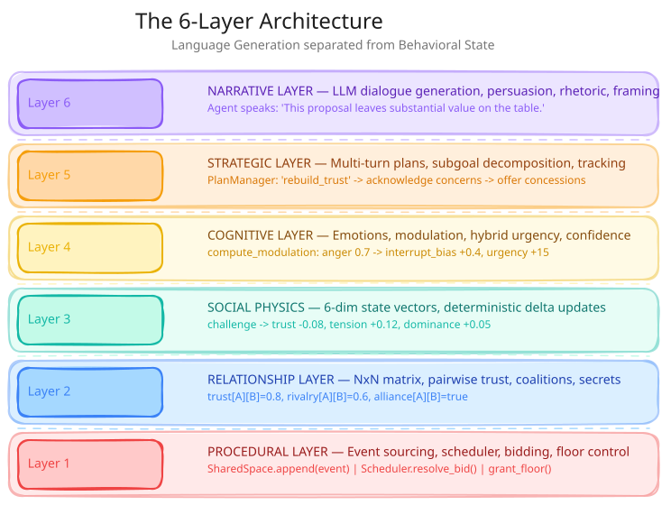
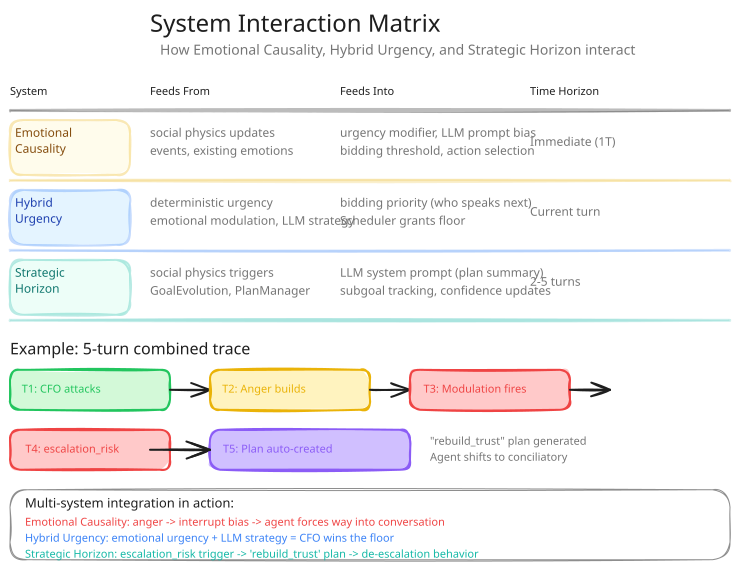
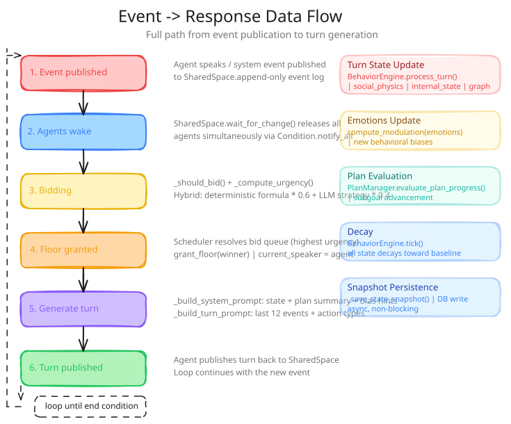
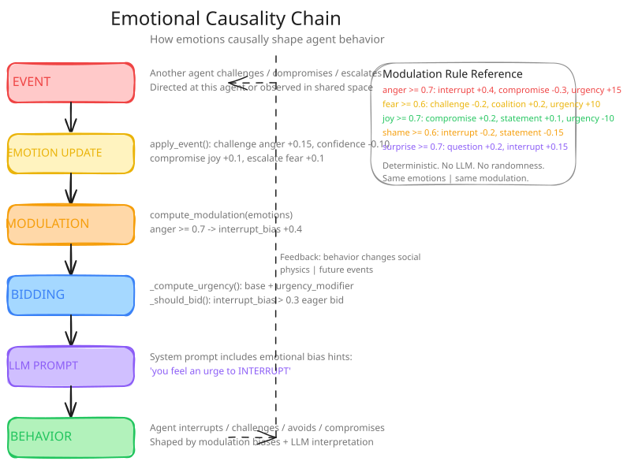
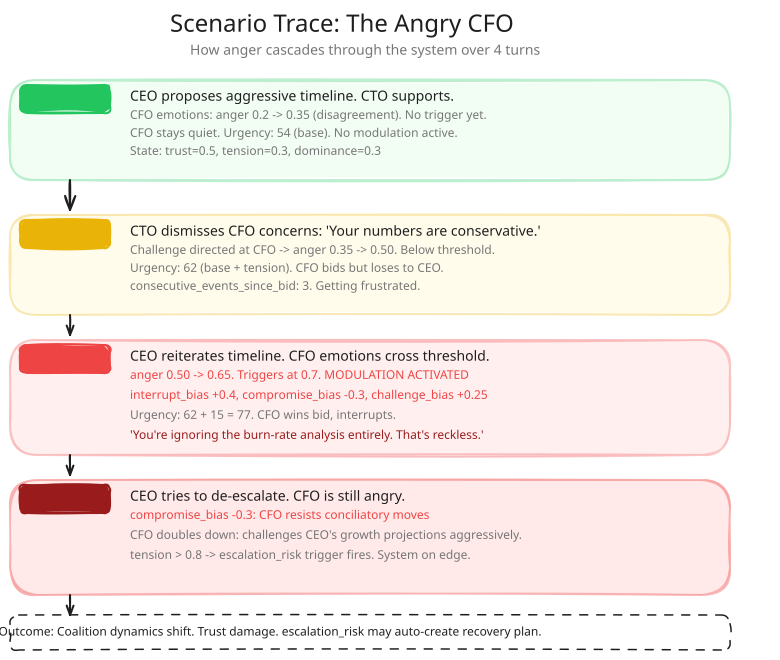

<div align="center">

# Boardroom Simulator

[](LICENSE)
[]()
[]()
[]()

</div>

A **synthetic social operating system** — multi-agent negotiation simulator where AI stakeholders with conflicting incentives debate, form coalitions, escalate, compromise, feel emotions, and execute multi-turn strategies.

Not a chatbot. An **event-driven cognitive society simulator**.

## Architecture

### Core Design Principle

**Language Generation** is separated from **Behavioral State Evolution**.

The LLM generates dialogue, tactical reasoning, and persuasive language.
Deterministic systems maintain coherence, social continuity, emotional state, and strategic evolution.

### 6-Layer Architecture

```
Layer 6: Narrative Layer (LLM)
Layer 5: Strategic Layer (planning, subgoals)
Layer 4: Cognitive Layer (emotions, modulation, urgency)
Layer 3: Social Physics Layer (trust, leverage, tension, etc.)
Layer 2: Relationship Layer (NxN pairwise matrix)
Layer 1: Procedural Layer (events, scheduling, bidding)
```

### What Makes This Different

| Aspect            | Typical Agent System  | This System                                                                  |
| ----------------- | --------------------- | ---------------------------------------------------------------------------- |
| **State**         | LLM context window    | Deterministic state machines + event sourcing                                |
| **Autonomy**      | Sequential turns      | Async, reactive, event-driven (`wait_for_change()`)                          |
| **Relationships** | Implicit in prompts   | Explicit NxN matrix (trust, fear, admiration, rivalry, alliance, dependency) |
| **Emotions**      | Described in text     | Numeric state with **causal behavioral effects**                             |
| **Strategy**      | None (reactive)       | Multi-turn plans with subgoal decomposition                                  |
| **Urgency**       | Round-robin or random | **Hybrid** — deterministic formula + LLM-inferred strategic importance       |
| **Debugging**     | Print statements      | Replay, state diff, 6+ visualization panels                                  |

### Six-Layer Architecture

[](docs/01-six-layer-architecture.excalidraw.svg)

### System Interaction Matrix

[](docs/05-system-interaction-matrix.excalidraw.svg)

## Behavioral Dynamics

### Emotional Causality

Emotions **causally shape behavior** — not just dialogue tone:

| Emotion         | Behavioral Effect                                      |
| --------------- | ------------------------------------------------------ |
| **anger** ≥ 0.7 | interrupt_bias +0.4, compromise_bias -0.3, urgency +15 |
| **fear** ≥ 0.6  | challenge_bias -0.2, coalition_bias +0.2               |
| **joy** ≥ 0.7   | compromise_bias +0.2, urgency -10                      |
| **shame** ≥ 0.6 | withdraws (speaks less, interrupts less)               |

### Hybrid Urgency

Bidding is **60% deterministic formula** (personality + state + emotions) **+ 40% LLM strategy score** (how much speaking now matters, judged from the last few turns plus facts such as "you were just addressed", turns left and a pending vote). The score has a short timeout (`STRATEGY_SCORE_TIMEOUT`, default 2.5s); on timeout, or for the agent who just spoke, the bid is the deterministic formula alone. `STRATEGY_MODEL` lets this call use a faster model than the dialogue.

### Strategic Horizon

Agents maintain **multi-turn plans** with subgoals. Each agent keeps a standing plan from its stance. Pressure (e.g., `trust_collapse`, `credibility_crisis`) adds a *tactical adjustment* ("rebuild trust", "defend position") on top of it, never replacing it. Repair tactics ("deescalate", "rebuild trust") come only from pressure other people put on the agent, not from the heat its own attacks create. A tactic expires a few turns after its pressure passes. Plans are injected into the LLM's system prompt each turn.

### Simulation Settings

| Setting | Values | Effect |
| ------- | ------ | ------ |
| `speaker_rules.mode` | `weighed_random` (bidding, default), `freeform` (highest bid wins), `moderator_led`, `alternating` | How the floor is assigned each turn |
| `scenario_type` | `debate`, `crisis`, `investor`, `podcast`, `legal`, `partnership` | Starting social/emotional climate and volatility |
| `stakeholders[].archetype` | `opportunist`, `idealist`, `diplomat`, `pragmatist`, `agitator`, `guardian` | Personality/emotion bias, action tendencies, delta multipliers |
| `env_flags.hidden_motives` | bool | Hidden agendas reach the agent's prompt and goals |
| `env_flags.time_pressure` | bool | Pressure rises toward the turn limit (announced, raises urgency and fear) |
| `env_flags.external_leaks` | bool | One external shock (leak, deadline, news, defection) hits mid-run |
| `env_flags.deadlock_risk` | bool | Agents are warned when the room nears deadlock |

Every turn names who it is `directed_at`, so challenges, compromises and coalition signals move the target's emotions and the pairwise relationship matrix. The prompt defines every action, because the engine updates state from the label: `compromise` puts terms on the table and `agreement` accepts the proposal on the table.

### How a Meeting Ends

Outcomes come only from what the agents do, never from mood alone:

| Ending | When |
| ------ | ---- |
| **Vote** (`end_condition: vote`) | Once about 40% of the turns remain, the chair calls the vote and asks each voter in turn (a holdout is asked once more). The motion carries when the yes share of the remaining voters reaches `threshold` (a fraction; a percentage like `60` is accepted). It fails once every voter has voted, or once a yes majority is out of reach. Voters default to every non-moderator. `vote` is only offered as an action when the meeting has a vote. |
| **Explicit agreement** | Every remaining non-moderator has answered the latest `compromise` with `agreement`, and its author has not attacked it since. |
| **Walkaway** | A `walkaway` removes the agent. The run ends when fewer than two non-moderators remain, or when everyone on one side (all champions or all detractors) has left. |
| **Consensus** (`end_condition: consensus`) | High trust and low tension held for 3 turns **and** every party has recently offered or accepted something. Sustained deadlock ends as an impasse, or as a walkaway if someone actually left. |
| **Timeout** | Turn limit reached without any of the above: no decision. Agents always see roughly how many turns are left. |

### Event Response Flow

[](docs/02-event-response-flow.excalidraw.svg)

### Emotional Causality Chain

[](docs/03-emotional-causality-chain.excalidraw.svg)

### Scenario Walkthrough: Angry CFO (Example)

[](docs/04-scenario-angry-cfo.excalidraw.svg)

## Personas (AI Stakeholders)

Reusable stakeholder library — 23 seeded personas across executive, finance, legal, technical, procurement, and comms roles. Each persona is a stable identity that persists across simulations.

| Field           | Example                                                      | Purpose                      |
| --------------- | ------------------------------------------------------------ | ---------------------------- |
| `name`          | "Priya Kapoor"                                               | Identity                     |
| `role`          | "Corp Dev VP"                                                | Functional hat               |
| `focus`         | risk posture, phased rollout readiness                       | Decision-making priorities   |
| `stance`        | champion / detractor / neutral / moderator / wildcard        | Starting position            |
| `personality`   | aggressiveness=40, empathy=70, stubbornness=30, verbosity=60 | 4-axis trait profile (0-100) |
| `hidden_agenda` | Needs a marquee AI partnership before fiscal year-end        | Private motivation           |
| `tag`           | SKEPTICAL / AGREEABLE / LOCKED / CALIBRATING / VISIONARY     | Behavioral label             |
| `tool_profile`  | financial / legal / technical / comms / none                 | Which tools the agent wields |
| `backstory`     | Free-text narrative                                          | Roleplaying context          |

### 6 Behavioral Archetypes

Archetypes bias emotion baselines and action tendencies — they define how a persona _feels by default_:

| Archetype       | Personality Bias                          | Emotion Bias          | Tendencies                    |
| --------------- | ----------------------------------------- | --------------------- | ----------------------------- |
| **Opportunist** | aggressive +10, empathy -10, stubborn -10 | joy +0.3, fear -0.1   | compromise 0.4, question 0.3  |
| **Idealist**    | aggressive -10, empathy +20, stubborn +30 | joy +0.2, anger +0.1  | statement 0.4, challenge 0.3  |
| **Diplomat**    | aggressive -20, empathy +30, stubborn -10 | joy +0.3, anger -0.1  | compromise 0.4, coalition 0.2 |
| **Pragmatist**  | neutral (no bias)                         | neutral               | balanced across all actions   |
| **Agitator**    | aggressive +30, empathy -20, stubborn +20 | anger +0.3, joy -0.1  | challenge 0.5, interrupt 0.3  |
| **Guardian**    | aggressive +10, empathy +10, stubborn +20 | fear +0.2, anger +0.1 | challenge 0.3, interrupt 0.2  |

### Persona Lifecycle

- **Library** (`/personas`) — browse, search, filter by stance or archetype
- **Editor** — create/edit name, role, backstory, personality sliders, stance, hidden agenda
- **Documents** — upload per-persona docs → Chroma embeddings → RAG-injected during simulation
- **Evolution** — simulations propose personality deltas; pending evolutions are reviewable
- **Cross-session memory** — key takeaways persist across simulations via Chroma

### Archetype Registry

Extensible `ArchetypeRegistry` at `backend/app/runtime/archetypes.py`. Custom archetypes can be registered at startup — no codegen required.

### From Persona to Agent

Each persona spawns an `AgentRuntime` with:

- **Private memory** — last 12 turn events with full context
- **Self-directed bidding** — urgency = personality base + emotion modulation + LLM strategy score (60/40 hybrid)
- **Emotional state machine** — anger/fear/joy/shame causally bias interrupt, challenge, compromise, coalition behavior
- **Strategic plans** — multi-turn subgoal decomposition; triggers auto-create plans (e.g., `trust_collapse` → "rebuild trust")
- **Knowledge injection** — Chroma RAG queries on each turn, drawing from uploaded docs + research + cross-session memory

## Demo

<video src="https://github.com/argahv/boardroom-simulator/raw/master/docs/assets/flow.mp4" controls width="100%"></video>

## Prerequisites

- Python 3.11+
- Node.js 20+
- OpenRouter API key (`OPENROUTER_API_KEY`)

## Quick Start

```bash
make install
make dev
```

Open `http://localhost:3000` in your browser. API docs at `http://127.0.0.1:8000/docs`.

### Manual Setup

```bash
# Backend
cd backend && python -m venv .venv && source .venv/bin/activate
pip install -r requirements.txt
cp .env.example .env   # add OPENROUTER_API_KEY
uvicorn app.main:app --reload --port 8000

# Frontend
cd frontend && npm install
echo 'NEXT_PUBLIC_API_URL=http://127.0.0.1:8000' >> .env.local
npm run dev
```

See [SETUP.md](SETUP.md) for the full setup guide, configuration options, and troubleshooting.

## Key Endpoints

| Method | Path                           | Description                        |
| ------ | ------------------------------ | ---------------------------------- |
| POST   | `/simulations`                 | Create simulation                  |
| GET    | `/simulations/{id}/stream`     | SSE stream (live)                  |
| GET    | `/simulations/{id}/replay`     | Ordered state snapshots for replay |
| GET    | `/simulations/{id}/export`     | Full simulation JSON download      |
| POST   | `/simulations/{id}/inject`     | Human turn injection               |
| POST   | `/simulations/{id}/postmortem` | LLM-generated analysis             |
| GET    | `/agents/{name}/detail`        | Agent profile + goals + strategy   |

Full API reference at `http://127.0.0.1:8000/docs`.

## Docs

| Doc                                                                | What's Inside                                                                                       |
| ------------------------------------------------------------------ | --------------------------------------------------------------------------------------------------- |
| [`docs/architecture-deep-dive.md`](docs/architecture-deep-dive.md) | Full component map, data flows, emergent properties, Layer 1-6 breakdown                            |
| [`docs/behavioral-dynamics.md`](docs/behavioral-dynamics.md)       | Emotional modulation rules, hybrid urgency mechanics, strategic planning scenarios, scenario traces |
| [`docs/ARCHITECTURE.md`](docs/ARCHITECTURE.md)                     | Behavior Engine architecture (v2 runtime)                                                           |
| [`docs/ROADMAP.md`](docs/ROADMAP.md)                               | Phased roadmap with success gates                                                                   |
| [`docs/tech-stack.md`](docs/tech-stack.md)                         | Technology decisions and rationale                                                                  |
| [`docs/snapshot-schema.md`](docs/snapshot-schema.md)               | State snapshot field reference                                                                      |

## Evaluation

The state engine and the language layer are evaluated separately, over replayable recordings.

**Recordings.** Every streamed run is saved to `RECORDINGS_DIR` (default `backend/data/recordings/`). Each turn carries the `prompt_state` the agent was conditioned on (emotions, modulation, social physics, plan/subgoal, goals, memory shown) and `llm` info (parse success, invented actions, inferred targets, tokens, latency). Floor events carry each agent's bid breakdown (deterministic components, LLM strategy score, final 60/40 blend). There is an initial state snapshot plus one after every turn.

| Layer | What is checked | Where |
| ----- | --------------- | ----- |
| Invariants (hard) | bounds, trigger activation, emotional modulation, challenge→anger/rivalry and compromise→trust cascades, 60/40 urgency blend, no repeat speakers, walked-out agents stay silent, alliance origins | `app/eval/invariants.py` |
| Metrics (no LLM) | archetype/action fidelity, emotion→action lift, subgoal alignment, repetition & voice collapse, turn-share Gini, parse/fallback/invented-action rates, target mention rate, agenda-leak heuristic, urgency calibration, coalition organicism, artificial-consensus/premature-vote/abrupt-walkaway flags, human-injection response, cost per turn | `app/eval/metrics.py` |
| LLM judge | per turn: persona, emotion, plan, action↔text, target, memory, public↔private consistency, rhetoric, agenda leak; per transcript: outcome believability, voice diversity, dynamics realism, artificial consensus | `app/eval/judge.py` |
| Scenarios | 12 fixed configs that each provoke one behavior, with expectations | `app/eval/scenarios.py` |

```bash
make test-engine                 # golden traces + property tests + eval tooling (no DB, no key)
make eval-offline                # all scenarios with the stub LLM (tests the harness, not quality)
make eval-baseline               # real LLM + judge, saves data/eval/baseline.json
make eval BASELINE=data/eval/baseline.json   # exits 1 on regressions or invariant violations

cd backend
python -m app.eval list                                  # scenarios + expectations
python -m app.eval score data/recordings --judge llm     # score real app runs
python -m app.eval calibrate --labels labels.jsonl data/recordings   # judge vs human labels
```

API: `GET /simulations/{id}/recording` (download), `POST /simulations/{id}/evaluate` (`{"judge": true, "judge_sample": 0.3}`).

**Tracing.** With `LANGSMITH_TRACING=true`, each simulation is one LangSmith trace: `boardroom_simulation` → `Turn N` → `bid · <agent>` / `speak · <agent>` LLM calls. Each judged recording is one `eval_judge · <simulation>` trace. If OpenRouter's own Broadcast to LangSmith is also enabled on the account, it adds a separate standalone "OpenRouter Request" trace for every call; turn it off, or point it at another project, to keep one tree per simulation.

Set `EVAL_JUDGE_MODEL` (default `openai/gpt-4.1`) to a different model than `OPENROUTER_MODEL`. Before trusting judge scores, hand-label about 50 turns (`{"simulation_id", "_index", "scores": {dim: 1-5}, "agenda_leak": bool}` per line) and run `calibrate`. It reports MAE, agreement and Spearman per dimension, and exits 0 only when the judge is trustworthy (within-1 agreement ≥ 0.8, MAE ≤ 1).

## Verification

```bash
# Using Make (recommended)
make test

# Or manually
cd backend && python -m pytest tests/
cd frontend && npx tsc --noEmit
```
